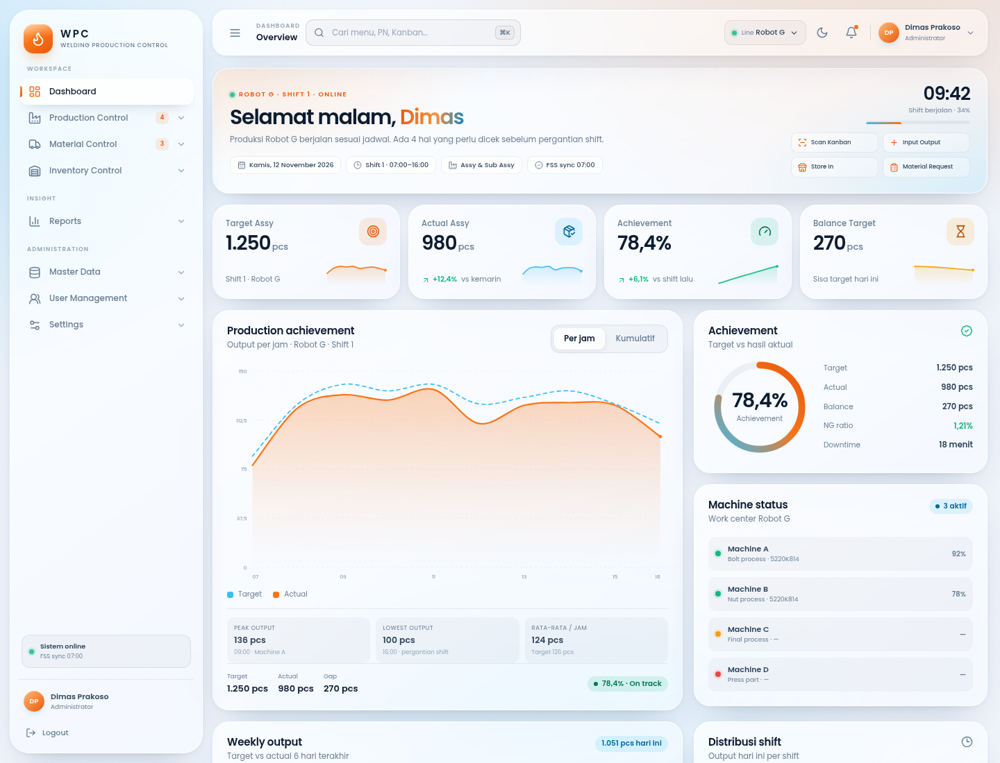
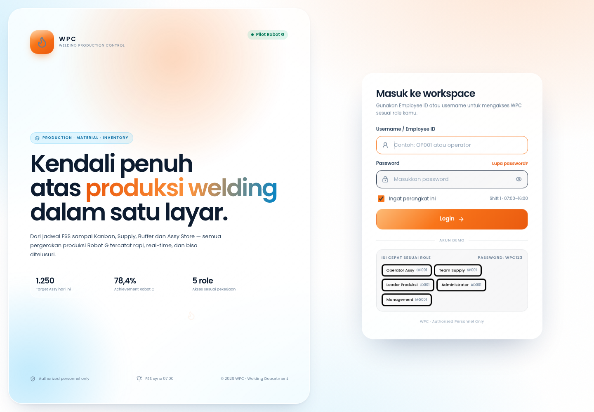
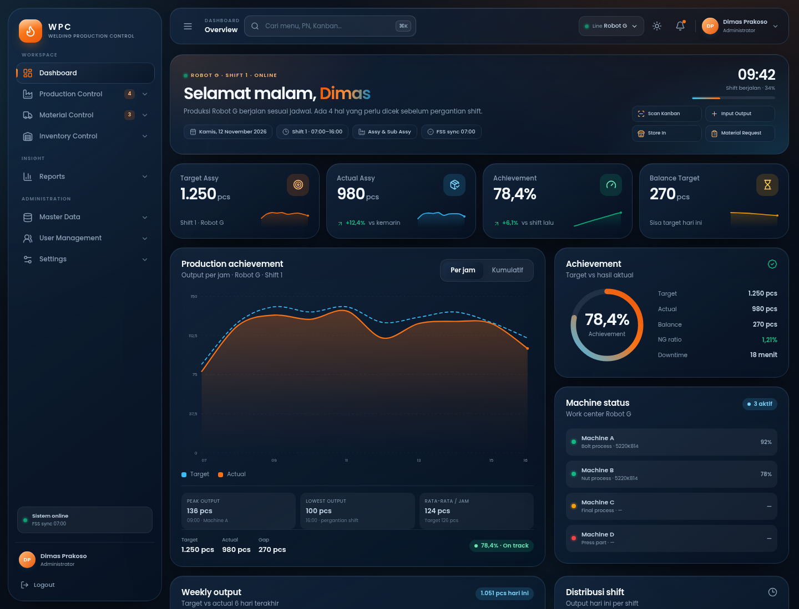
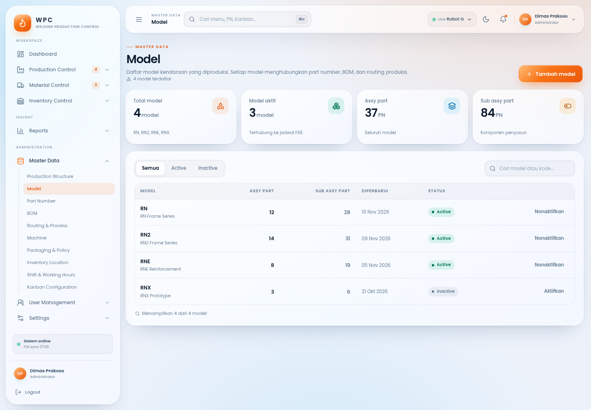
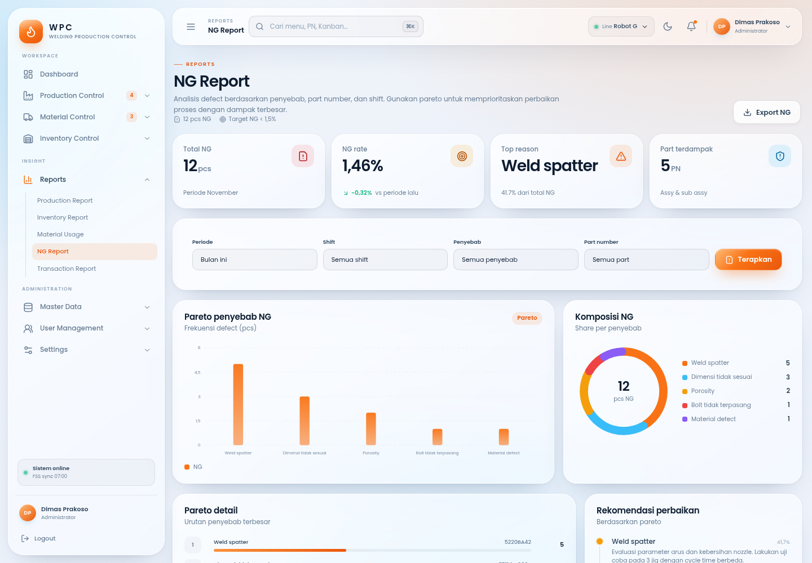
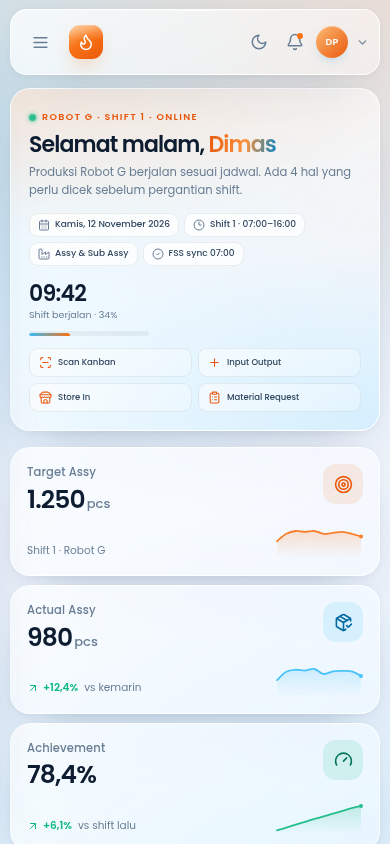

# WPC — Welding Production Control

Frontend aplikasi **Welding Production Control (WPC)** berbasis **React + TypeScript** dengan tema
**orange + light blue liquid glass**, font **Poppins**, ikon **Lucide**, serta dukungan **light mode
dan dark mode**. Seluruh modul pada blueprint `fe/WPC_Application_Menu_UI_Blueprint.html` sudah
direpresentasikan sebagai halaman terpisah dengan data demo yang saling terhubung.



---

## 1. Ringkasan fitur

- **Login & role-based access** — login JWT ke backend, area kerja operator dari database, dan menu/route sesuai hak akses.
- **Dashboard** — KPI, area chart target vs actual, bar chart output, donut distribusi shift,
  radial gauge achievement, sparkline, status mesin, antrian, alert material, dan aktivitas.
- **Production Control** — jadwal Assy, produksi Assy, antrian Sub Assy, produksi Sub Assy,
  hasil produksi.
- **Material Control** — permintaan material, pickup supply, return material, scan pickup Assy,
  external material, penerimaan material.
- **Inventory Control** — stock overview, production buffer, Assy store, Sub Assy store,
  mutasi stok, stock adjustment.
- **Master Data** — model, part number, BOM (pilih Assy untuk melihat komposisi), cycle time
  dengan target item/jam 85%, machine/line, stock policy, inventory location, shift, dan
  konfigurasi kanban yang dapat diedit.
- **Reports** — production, inventory, material usage, NG (pareto), transaction.
- **User Management** — user list, roles & permissions, device management.
- **Settings** — profile, preferences, notifications, FSS integration, barcode & printing,
  security, backup & maintenance.
- **Responsive** — mobile (≤640px), tablet (≤1024px), desktop, dan layar lebar.
  Sidebar desktop dapat di-collapse lewat tombol hamburger; pada tablet/mobile menjadi drawer.
- **Tema** — light/dark mode tersimpan di `localStorage`, mengikuti preferensi sistem saat pertama
  dibuka.

| Login | Dark mode |
| --- | --- |
|  |  |

| Master Data | Reports |
| --- | --- |
|  |  |



---

## 2. Teknologi

| Kebutuhan | Implementasi |
| --- | --- |
| Framework | React 18 |
| Bahasa | TypeScript 5.6 |
| Build tool | Vite 5 |
| Routing | React Router 6 |
| Ikon | `lucide-react` |
| Styling | CSS murni dengan design tokens (tanpa Tailwind) |
| Chart | Komponen SVG buatan sendiri (`AreaChart`, `BarChart`, `DonutChart`, `RadialGauge`, `Sparkline`) |
| Font | Poppins (Google Fonts) |
| State | React Context (`AuthContext`, `QueueContext`, `ThemeContext`) + API backend |
| Backend | Express + Prisma (`../backend`), diakses lewat proxy `/api` |

---

## 3. Cara menjalankan

Prasyarat: **Node.js 18+** dan npm.

Prasyarat tambahan: **backend WPC** berjalan di `http://localhost:4000` dan database sudah di-seed
(lihat `../backend/README.md`).

```bash
# 1. Masuk ke folder frontend
cd frontend

# 2. Install dependency
npm install

# 3. Jalankan backend di terminal lain
cd ../backend && npm run dev

# 4. Jalankan frontend
npm run dev
```

Buka `http://localhost:5173`. Vite mem-proxy `/api` ke `http://localhost:4000`, sehingga tidak perlu
konfigurasi CORS untuk development. Untuk backend di host lain, salin `.env.example` menjadi `.env`
dan isi:

```text
VITE_API_URL=http://alamat-backend:4000/api
```

### Integrasi backend saat ini

Sudah tersambung penuh:

- Login/logout, sesi JWT, profil pengguna, dan daftar area kerja operator.
- Scan kanban Supply (perlu login), daftar permintaan, alokasi shift + auto Sub Assy dari BOM,
  antrean produksi, prioritas, urutan antrean, dan cetak kanban.
- Penyimpanan hasil produksi OK/NG per shift, rekap hasil, serta riwayat aktivitas antrean.

Halaman master data, inventory, material, reports, users, dan settings **masih memakai data demo**
dan akan disambungkan pada tahap berikutnya. Scan Supply sekarang memerlukan akun karena backend
mewajibkan otorisasi untuk setiap transaksi.

### Script yang tersedia

```bash
npm run dev        # Development server (hot reload)
npm run build      # Typecheck + build produksi ke folder dist/
npm run preview    # Preview hasil build
npm run typecheck  # TypeScript check tanpa build
```

Untuk build produksi:

```bash
npm run build
npm run preview
```

> Aplikasi memakai font Poppins dari Google Fonts. Jika lingkungan produksi offline, unduh font
> Poppins dan host secara lokal, lalu sesuaikan `src/styles/tokens.css` / `index.html`.

---

## 4. Akun demo

Password semua akun: **`wpc123`**

| Role | Username | Employee ID | Nama | Akses utama |
| --- | --- | --- | --- | --- |
| Operator Assy | `operator.assy` | `OA001` | Andri Setiawan | Antrian dan produksi Assy |
| Operator Sub Assy | `operator.subassy` | `OS001` | Rizky Anu | Antrian dan produksi Sub Assy |
| Leader Produksi | `leader` | `LD001` | Uuk Riyanto | Produksi, material, inventory, reports, master, settings |
| Administrator | `admin` | `AD001` | Ahmad Galih | Seluruh modul |
| Management | `management` | `MG001` | Puji Utomo | Dashboard, reports, settings |

Login memakai **username** atau **Employee ID** dan divalidasi backend. Contoh: `OA001` / `wpc123`.
Setelah kredensial operator benar, operator memilih area kerja yang ditugaskan Admin (misalnya
Robot G · Assy atau Robot G · SS.H). Area aktif dapat diganti melalui top bar; role tetap membatasi
jenis pekerjaan yang bisa dibuka. Stasiun scan di `/supply/scan` juga memerlukan login.

Penugasan area tersimpan di database dan diatur lewat **User Management → User List**. Akun demo
OA001 mendapat seluruh area Assy Robot G; OS001 mendapat seluruh area Sub Assy Robot G.

Cycle time diisi dalam **detik per item** pada **Master Data → Cycle Time & Capacity**. Target
ditampilkan dengan rumus `3600 ÷ cycle time × 0,85` dan dapat difilter berdasarkan line, tipe
Assy/Sub Assy, serta project/model. Form User List memakai satu nilai Line/Area; penugasan area
proses operator tetap diatur terpisah sesuai role.

Shift aktif mengikuti jam lokal perangkat, hari kerja, dan konfigurasi pada **Shift & Working Hours**.
Waktu istirahat dianggap nonaktif; waktu setelah tengah malam pada shift malam menjadi bagian dari
hari produksi saat shift dimulai. Jam shift aktif yang bertumpang tindih ditolak. Input hasil dan
aksi antrean operator tidak tersedia di luar waktu shift aktif.

Hasil dapat dicatat sebagai total kumulatif OK/NG per part dan shift; menyimpan ulang akan
memperbarui total, bukan menambahkan angka. Penyelesaian Kanban tetap memperbarui antrean dan
menambah OK otomatis. Jika total shift disimpan, box yang selesai sebelum penyimpanan sudah
tercakup di total dan tidak dihitung dua kali; box yang selesai sesudahnya ditambahkan otomatis.
Operator tidak perlu memasukkan hasil angka setelah setiap pallet/box.

Sesi frontend disimpan di `localStorage` dengan key `wpc.session.v2`, sedangkan token JWT di
`wpc.api-token.v1`. Data produksi (permintaan, antrean, completed box, hasil shift, NG, audit)
berada di database dan dibagi antar perangkat. Key demo lain yang masih dipakai halaman belum
tersambung: `wpc.production-cycle-times.v2`, `wpc.shift-config.v1`, `wpc.workdays.v1`, `wpc.theme`,
dan `wpc.sidebar`.

### Batas integrasi

- Autentikasi, area kerja, scan, alokasi, antrean, cetak kanban, dan hasil/NG sudah memakai backend.
- Halaman master, inventory, material, reports, users, settings, dashboard, dan jadwal masih membaca
  `src/data/mock.ts` atau `localStorage`; perubahan di halaman tersebut belum masuk database.
- `src/data/accounts.ts` masih dipakai untuk label role dan validasi tipe role, bukan untuk
  memverifikasi password.
- Token JWT disimpan di `localStorage` untuk pilot internal. Untuk produksi publik, pertimbangkan
  cookie httpOnly + refresh token.
- Validasi otorisasi dan seluruh aksi produksi tetap dilakukan server; frontend hanya menyembunyikan
  aksi yang tidak tersedia untuk role tertentu.

---

## 5. Struktur project

```text
wpc-frontend/
├─ public/
│  └─ flame.svg                  # favicon / aset logo publik
├─ src/
│  ├─ assets/
│  │  └─ flame.svg               # logo asli yang dirender inline (FlameIcon)
│  ├─ components/
│  │  ├─ auth/                   # AuthLayout
│  │  ├─ brand/                  # FlameIcon, BrandMark, BrandLockup
│  │  ├─ charts/                 # AreaChart, BarChart, DonutChart, RadialGauge, Sparkline
│  │  ├─ layout/                 # AppShell, Sidebar, Topbar, ModuleTabs, RequireAuth, RoleGuard
│  │  └─ ui/                     # GlassCard, Button, Badge, DataTable, Field, Tabs, dll.
│  ├─ config/
│  │  └─ access.ts               # Pemetaan role → route
│  ├─ contexts/
│  │  ├─ AuthContext.tsx
│  │  └─ ThemeContext.tsx
│  ├─ data/
│  │  ├─ accounts.ts             # Akun demo
│  │  ├─ mock.ts                 # Seluruh data demo
│  │  └─ navigation.ts           # Struktur menu + role
│  ├─ hooks/
│  │  ├─ useClickOutside.ts
│  │  └─ useMediaQuery.ts
│  ├─ lib/
│  │  └─ utils.ts                # cn(), formatNumber(), formatPercent(), dll.
│  ├─ pages/
│  │  ├─ auth/                   # LoginPage, ForgotPasswordPage
│  │  ├─ dashboard/              # DashboardPage
│  │  ├─ production/             # 5 halaman produksi
│  │  ├─ material/               # 6 halaman material
│  │  ├─ inventory/              # 6 halaman inventory
│  │  ├─ master/                 # 10 halaman master data
│  │  ├─ reports/                # 5 halaman laporan
│  │  ├─ users/                  # 3 halaman user management
│  │  ├─ settings/               # 7 halaman settings
│  │  └─ NotFoundPage.tsx
│  ├─ styles/
│  │  ├─ tokens.css              # Warna, radius, shadow, typography, variabel tema
│  │  ├─ components.css          # Komponen UI & chart
│  │  ├─ layout.css              # Shell, sidebar, topbar, page frame, auth, responsif
│  │  ├─ pages.css               # Komposisi halaman & breakpoint tambahan
│  │  └─ index.css               # Entry import seluruh stylesheet
│  ├─ types/
│  │  └─ index.ts                # Tipe data bersama
│  ├─ App.tsx                    # Provider + seluruh route
│  └─ main.tsx                   # Entry React
├─ index.html
├─ package.json
├─ tsconfig*.json
└─ vite.config.ts
```

Setiap halaman berada di file sendiri dan menggunakan komponen bersama dari `components/ui` serta
data dari `src/data/mock.ts`. Penambahan halaman baru cukup membuat file di `pages/`, menambah route
di `App.tsx`, dan (jika perlu) entri menu di `data/navigation.ts` + `config/access.ts`.

---

## 6. Rute aplikasi

| Modul | Rute |
| --- | --- |
| Auth & Supply Scan | `/login`, `/forgot-password`, `/supply/scan` |
| Dashboard | `/` |
| Production | `/production/schedule`, `/production/assy-queue`, `/production/assy`, `/production/queue`, `/production/sub-assy`, `/production/results` |
| Material | `/material/request`, `/material/pickup`, `/material/return`, `/material/assy-pickup`, `/material/external`, `/material/receiving` |
| Inventory | `/inventory/overview`, `/inventory/buffer`, `/inventory/assy-store`, `/inventory/sub-assy-store`, `/inventory/ledger`, `/inventory/adjustment` |
| Master Data | `/master/structure`, `/master/models`, `/master/parts`, `/master/bom`, `/master/routing`, `/master/machines`, `/master/stock-policy`, `/master/locations`, `/master/shifts`, `/master/kanban` |
| Reports | `/reports/production`, `/reports/inventory`, `/reports/material-usage`, `/reports/ng`, `/reports/transactions` |
| Users | `/users/list`, `/users/roles`, `/users/devices` |
| Settings | `/settings/profile`, `/settings/preferences`, `/settings/notifications`, `/settings/printing`, `/settings/backup` |

Hak akses diatur di `src/data/navigation.ts` (menu) dan `src/config/access.ts` (route). Route yang
tidak diizinkan akan menampilkan halaman **“Akses dibatasi”**, bukan error.

---

## 7. Tema dan kustomisasi

Semua design token berada di **`src/styles/tokens.css`**:

```css
--accent: #f97316;        /* orange utama */
--sky: #38bdf8;           /* light blue */
--glass-bg: ...;          /* latar liquid glass */
--glass-border: ...;
--radius-lg: ...;
--shadow-soft: ...;
```

Light dan dark mode memakai selector `[data-theme='dark']`. `ThemeContext` mengatur atribut
`data-theme` pada `<html>` dan menyimpan pilihan di `localStorage`.

Untuk mengganti logo, ganti isi `src/assets/flame.svg` (dipakai inline oleh `FlameIcon`) dan
`public/flame.svg` (favicon). Logo tampil di halaman login, sidebar, dan dashboard.

---

## 8. Catatan implementasi

- **Data**: alur inti produksi, pengaturan, dan Jadwal Assy memakai backend/database. Sebagian
  halaman laporan masih memakai data demo.
- **Auth**: kredensial divalidasi backend dan token dipakai pada setiap request API. Sesi divalidasi
  ulang lewat `GET /api/auth/me` saat aplikasi dibuka.
- **Chart**: dibuat dengan SVG agar ringan, responsif, dan mudah disesuaikan tanpa dependency chart
  eksternal. Tooltip mengikuti pointer dan mendukung layar sentuh.
- **Aksesibilitas**: tombol navigasi memiliki `aria-label`, chart memiliki `role="img"` dan label,
  switch memakai `role="switch"`, serta tabel memiliki header semantik.
- **Browser**: Chrome, Edge, Firefox, dan Safari versi modern (mendukung `backdrop-filter`).

---

## 9. Checklist requirement

- [x] React + TypeScript + Vite
- [x] Tema orange & light blue liquid glass
- [x] Font Poppins
- [x] Lucide icons
- [x] Light & dark mode
- [x] Login + role-based navigation
- [x] Dashboard dengan banyak chart dan visual
- [x] Halaman terpisah untuk setiap modul/fungsi
- [x] Sidebar Apple-style yang dapat dibuka/ditutup dengan hamburger
- [x] Responsif mobile, tablet, desktop, dan PC
- [x] Logo `flame.svg` pada login dan dashboard
- [x] Kode terstruktur, setiap halaman/fungsi di file sendiri
- [x] Panduan instalasi dan penggunaan (dokumen ini)

---

Dibuat untuk kebutuhan pilot **WPC — Welding Production Control**, Robot G.
